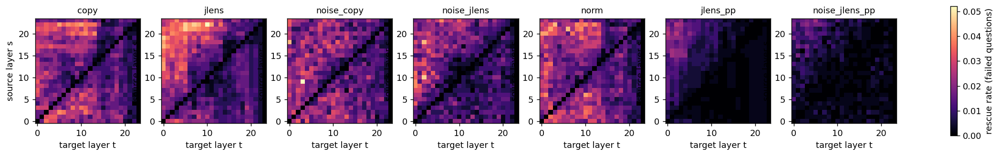
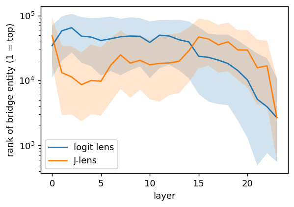
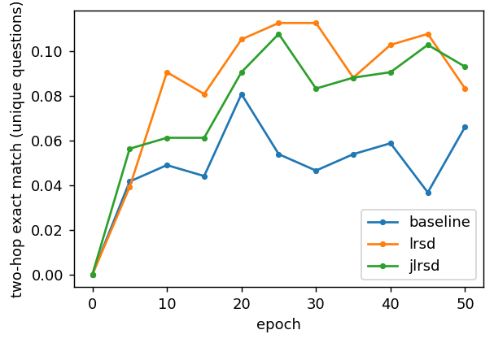

# Does Jacobian-lens transport fix the paper's cross-layer copies?

**Short answer: no.**
- Replacing the raw copy with J-lens transport does not rescue more failed two-hop answers. On the paper's oracle it rescues significantly fewer (29.4% vs 35.2% of failed questions, McNemar p = 0.0016). After correcting for perturbation size, the two are not distinguishable.
- A control matters more for interpreting the paper's oracle: random perturbations of the same size rescue more questions than either transport (44.8% for random directions matched to the copy). On this model the best-of-576 oracle mostly measures how easily near-miss answers flip, not knowledge that is stored but misplaced.
- Experiment 2 (LRSD vs J-space LRSD) and the per-position-Jacobian ablation are reported below.

Setup:
- Model: Qwen2.5-0.5B-Instruct. Data: the paper's 1000-fact injection sample (seed 848: 500 two-hop rows, 409 unique questions).
- Training: LoRA r = 8, lr 1e-4, batch 10, 50 epochs. One seed and one checkpoint.
- Method, statistics and code: [docs/jtransport.md](../../docs/jtransport.md). Raw numbers: [`exp1.json`](exp1.json), [`exp2.json`](exp2.json).

## 0. Knowing–using gap (baseline, λ = 0)

| epoch | 5 | 10 | 20 | 30 | 40 | 50 |
|---|---|---|---|---|---|---|
| memorization (1toN EM) | 69.2% | 94.3% | 98.4% | 99.5% | 99.4% | 98.1% |
| two-hop EM (unique questions) | 4.2% | 4.9% | 8.1% | 4.6% | 5.9% | 6.6% |

The paper's gap reproduces on a model it did not test: the facts are memorized by epoch 10, but two-hop accuracy stays near 6%. At epoch 50, 23% of two-hop answers are the *bridge* entity (`chain_bridge_rate` 0.23). The model performs the first hop and stops. In the grid (TransformerLens, TF32), the unpatched model answers 25 of the 409 questions (6.1%).

## 1. Self-patching: copy vs. J-lens transport vs. controls

There are 384 failed questions. A question counts as rescued if any off-diagonal (s, t) cell answers it (the paper's oracle):

| arm | rescued (of 384 failed) | rescuing cells / failed q | share of rescuing cells with s > t | mean ΔMRR per cell (all / s > t) | LRSD pair (18→12): rescues / harms |
|---|---|---|---|---|---|
| `copy` (paper) | **35.2%** | 9.4 | 56.9% | +0.0194 / +0.0227 | 7 / 13 |
| `jlens` | 29.4% | 9.1 | 68.6% | +0.0152 / +0.0240 | 10 / 6 |
| `noise_copy` | 44.8% | 9.1 | 58.4% | +0.0156 / +0.0211 | 8 / 20 |
| `noise_jlens` | 40.4% | 7.2 | 66.8% | +0.0101 / +0.0154 | 7 / 10 |
| `norm` | 38.3% | 9.6 | 58.3% | +0.0175 / +0.0206 | 11 / 13 |

Row-level numbers in the paper's format (`patch/compute_oracle.py`, N = 500 rows): no-patch 5.0%, oracle 40.2% for copy (8.0×) and 35.0% for jlens.

Paired contrasts over the 384 failed questions, with bootstrap 95% CIs:

| contrast | difference | 95% CI |
|---|---|---|
| copy − noise_copy (rescued) | −9.6 pp | [−13.5, −5.7] |
| jlens − noise_jlens (rescued) | −10.9 pp | [−15.1, −6.8] |
| **jlens − copy (rescued)** | **−5.7 pp** | [−9.1, −2.3]; McNemar: only jlens 12, only copy 34, p = 0.0016 |
| (jlens − noise_jlens) − (copy − noise_copy) | −1.3 pp | [−6.5, +3.9] |
| ΔMRR copy − noise_copy (all cells) | +0.0037 | [+0.0007, +0.0069] |
| ΔMRR jlens − noise_jlens (all cells / s > t) | +0.0051 / +0.0086 | [+0.0022, +0.0081] / [+0.0017, +0.0156] |
| ΔMRR jlens − copy (all cells / s > t) | −0.0042 / +0.0013 | [−0.0086, +0.0002] / [−0.0054, +0.0080] |

A 2-fold cross-validated single layer pair (chosen on half of the failed questions, scored on the other half) rescues 2.3% for copy, 2.9% for jlens, 4.2% for noise_copy and 3.9% for noise_jlens. Each fold has about 190 questions, so these differences are within noise.

How to read these results:

1. **The paper's oracle signal is mostly perturbation, at least at this scale.** Random directions, matched cell by cell to the copy's perturbation size, rescue more questions than the copy itself. The heatmaps show the difference in kind. Copy and jlens rescue in a structured region, late source layers into early and middle target layers, which is the paper's back-patching picture. Noise rescues sparsely in every cell. Because each noise cell is an independent attempt, the any-cell oracle favours noise. The per-cell MRR gain does not reward diversity, and there the structured arms beat noise only slightly (+0.004 to +0.009). The copy carries some answer-specific information, but the 8× "restore oracle" mostly reflects how many near-miss answers a large perturbation can flip.
2. **The J-lens transport does not help.** It rescues significantly fewer questions than the copy. It also perturbs half as much (‖x − h_t‖/‖h_t‖ = 0.72 vs 1.41 for copy), and corrected for that through the matched noise, the two are indistinguishable (−1.3 pp, CI [−6.5, +3.9]). Its differences are qualitative and small:
   - it concentrates rescues more in s > t (68.6% vs 56.9% of cells);
   - it is the only arm whose fixed-pair patches are not net-harmful (LRSD pair 18→12: +10 / −6);
   - its back-patch MRR gain over noise is the largest (+0.0086).
3. **This matches the prediction recorded before the run.** In the linear limit, `pinv(J_t) J_s h_s ≈ h_t`: a geometry-preserving transport undoes what layers t+1..s computed, and that computation is exactly what back-patching re-runs. The transport keeps only the nonlinear remainder, plus estimation error.

### J-lens diagnostics

- **Conditioning.** The fitted Jacobians (2 × 100 pile-10k prompts × 128 tokens, fine-tuned model) are very ill-conditioned: κ(J_l) ranges from 5.6e3 to 1.6e6. Split-half stability allows only the strongest ridge tried:

  | c | 0.1 | 0.03 | 0.01 | 0.003 |
  |---|---|---|---|---|
  | split-half instability | 0.17 | 0.36 | 0.68 | 1.07 |

  At c = 0.1 the transported state reproduces the source's J-lens readout with a 34% relative error. An exact pinv transport (c → 0) is dominated by estimation noise.
- **Bridge readout.** At the last head-entity token, the bridge entity (the first hop's answer) is almost never readable at any layer: ≤ 1% of questions have it in the top 10, under the logit lens and under the J-lens alike. The J-lens ranks it better than the logit lens in layers 1–14 (median rank ≈ 1–3·10⁴ vs ≈ 4–6·10⁴), and worse at layer 0 and in layers 15–22. This late-layer weakness motivated the per-position ablation below.

  

## 2. LRSD vs. J-space LRSD (experiment 2)

All arms use the same injection recipe and seed (848) and the pair (s, t) = (18, 12). The J-space loss uses the base model's J-lens. Two-hop exact match is measured on the 409 unique questions (any gold answer), every 5 epochs:

LAMBDA_TABLE

- **LRSD reproduces in direction on this model.** From epoch 10 on, both LRSD variants stay above the baseline at every evaluation. The final-epoch differences are not significant with one seed (exact McNemar on final per-question correctness).
- **J-space LRSD does not beat LRSD.** At λ = 1 it ends 1.0 pp higher (9.3% vs 8.3%; 26 vs 22 questions only one arm gets right, p = 0.67) and has a slightly lower mean over epochs. The J-space objective also behaves very differently during training:
  - **Loss trajectory.** The raw LRSD loss falls from 0.36 to 0.0004: the model learns to make the middle-layer entity state almost equal the late-layer state on the training prompts. The J-space loss falls from 0.31 to 0.16 by epoch 25 and stays there. Matching the J-lens *readouts* of layers 12 and 18 is a constraint LoRA cannot satisfy.
  - **Memorization.** At λ = 1 the J-space term competes with fact learning. Memorization reached only 10% by epoch 10 (raw LRSD: 80%), and it caught up only after epoch 20.

## 3. Ablation: per-position (same-token) Jacobian

`jlens` estimates `J_l = E[Σ_{p'≥p} ∂h_final[p']/∂h_l[p]]`, which includes how the state at token p moves every later token. Self-patching keeps the state at its own token, so the ablation fits the same-token Jacobian `E_p[∂h_final[p]/∂h_l[p]]`:
- 2 halves × 40 pile prompts × 4 sampled positions each (`lens.per_position_jacobian_for_prompt`).
- A GPU test checks it against `jlens` in the one-valid-position case.

| | `jlens` J (sum over later tokens) | per-position J |
|---|---|---|
| ‖J − I‖ / ‖I‖, layers 0 / 12 / 22 | 1.27 / 1.21 / 0.51 | 1.01 / 0.92 / 0.49 |
| ‖J‖ ratio (sum / per-position), layers 0–12 | 2.2–2.6× | 1 |
| split-half instability at c = 0.1 / 1 | 0.17 / – | 0.66 / 0.34 |
| selected ridge c, rel. perturbation of the transport | 0.1, 0.72 | 1 (none stable, so the strongest), 0.10 |
| rescued of 384 failed (matched noise) | 29.4% (40.4%) | 9.6% (10.4%) |

The same-token Jacobian is closer to the identity but still far from it. It is much noisier per sample, and at this budget (320 position samples per half) no tested ridge makes the transport split-half stable. At the strongest ridge the transport perturbs only 10% of ‖h_t‖ and rescues what its matched noise rescues (−0.8 pp, CI [−3.4, +1.8]).

Its bridge readout is the best of the three lenses in layers 1–6 (median rank ≈ 5·10³). Like the other J-lens, it is worse than the logit lens in layers 15–22, and it never reaches the top 10: [bridge_readout_pp.png](bridge_readout_pp.png).

This is the prediction in its plainest form: a reliably estimated, geometry-preserving transport of the full state is close to "no patch".

## Verdict

| question | answer on Qwen2.5-0.5B, 1000 injected facts, 1 seed |
|---|---|
| Are layer coordinates different? | Yes. `J_l` is far from the identity (‖J − I‖/‖I‖ ≈ 0.5–1.3) and badly conditioned (κ 10⁴–10⁶). |
| Does J-lens transport rescue more failed two-hop answers than the raw copy? | No. It rescues fewer: −5.7 pp, p = 0.0016. Corrected for its smaller perturbation the two are equal: −1.3 pp, CI [−6.5, +3.9]. |
| Does a same-token Jacobian help? | No. Once it is stable it is a near no-op and equals its noise control. |
| Does the raw copy itself beat random perturbations of the same size? | Not on the oracle (−9.6 pp). There is a small per-cell MRR edge (+0.004). The paper's restore-oracle is largely a perturbation effect at this scale. |
| Does J-space LRSD beat LRSD? | No significant difference at λ = 1 (p = 0.67)LAMBDA01_VERDICT. Both beat the baseline in direction; neither is significant with one seed. |

The coordinate mismatch the J-lens reveals is real, but correcting for it doesn't help these interventions. Back-patching works, to the extent it works, because later layers re-process a state that has already been through them. Translating the state into the target layer's coordinates removes exactly that.

## Caveats

- One small model (0.5B, which the paper does not use), one seed, one fine-tuned checkpoint. The paper's larger models may show a copy advantage over noise that this model lacks.
- The J-lens was fitted on generic text (pile-10k), as the J-lens paper does, not on the chat-formatted biomedical prompts.
- The grids use TF32 matmuls. On a sample this changed ≤ 0.02% of exact-match cells, identically across arms. Near-tie flips of the unpatched answer appear in 1 row × 1 diagonal cell for two arms.
- The exact match of baseline-correct questions is gated on a rank-1 first token, so harms are counted only where greedy decoding could start with the answer.
